# computer-science-lab4
Лабораторная работа №4

**Тема:** Анализ набора данных с помощью SQL  
**Предметная область примера:** образовательная платформа  
**СУБД:** SQLite  
**Файл базы:** `dataset.sqlite`

## Шаг 1. Загрузка базы и первичная проверка

В SandboxSQL загружена SQLite-база. Выполнена проверка числа строк во всех шести таблицах.

**Количество записей.** 

```sql
SELECT 'groups' AS table_name, COUNT(*) AS rows_count FROM groups UNION ALL SELECT 'students', COUNT(*) FROM students UNION ALL SELECT 'teachers', COUNT(*) FROM teachers UNION ALL SELECT 'courses', COUNT(*) FROM courses UNION ALL SELECT 'enrollments', COUNT(*) FROM enrollments UNION ALL SELECT 'results', COUNT(*) FROM results;
```

**Результат:**

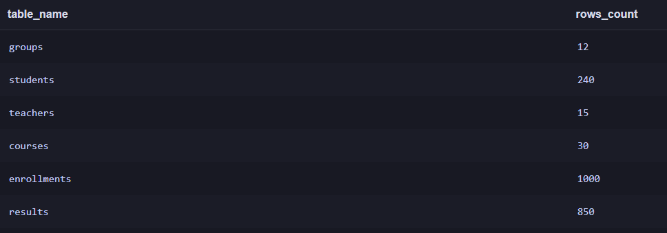

**Вывод:** все шесть таблиц доступны, всего 2147 записей.

## Шаг 2. Изучение структуры и формулирование аналитических вопросов

База содержит шесть связанных таблиц:

| Таблица | Назначение | Основные поля | Записей |
|---|---|---|---:|
| `groups` | Учебные группы | `id`, `group_name`, `study_year` | 12 |
| `students` | Студенты | `id`, `full_name`, `group_id`, `admission_year` | 240 |
| `teachers` | Преподаватели | `id`, `full_name`, `department` | 15 |
| `courses` | Учебные курсы | `id`, `course_name`, `hours`, `teacher_id` | 30 |
| `enrollments` | Записи на курсы | `id`, `student_id`, `course_id`, `enrolled_at`, `status` | 1000 |
| `results` | Результаты обучения | `id`, `enrollment_id`, `score`, `completed_at` | 850 |

Связи: `students.group_id → groups.id`; `courses.teacher_id → teachers.id`; `enrollments.student_id → students.id`; `enrollments.course_id → courses.id`; `results.enrollment_id → enrollments.id`. В каждой таблице `id` — первичный ключ. Для `results.enrollment_id` задана уникальность: одной записи на курс соответствует максимум один результат с оценкой.

**Просмотр данных.** Просмотр первых пяти записей на курсы.

```sql
SELECT * FROM rentals LIMIT 5;
```

**Результат:**

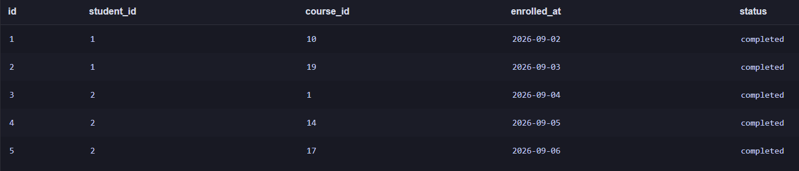

**Структура таблицы.** Просмотр полей и типов данных таблицы `enrollments`.

```sql
PRAGMA table_info(enrollments);
```

**Результат:**

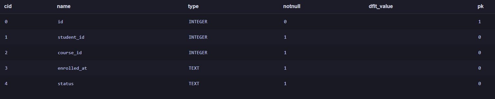

**Первичные и внешние ключи. Связи между таблицами**

В базе данных используются первичные ключи (`PRIMARY KEY`) для идентификации записей и внешние ключи (`FOREIGN KEY`) для связи таблиц.

- `groups.id` — первичный ключ учебной группы.
- `students.id` — первичный ключ студента.
- `teachers.id` — первичный ключ преподавателя.
- `courses.id` — первичный ключ учебного курса.
- `enrollments.id` — первичный ключ записи на курс.
- `results.id` — первичный ключ записи с результатом.

**Связи между таблицами:**

- `students.group_id → groups.id` — каждый студент привязан к конкретной учебной группе.
- `courses.teacher_id → teachers.id` — каждый курс закреплен за определенным преподавателем.
- `enrollments.student_id → students.id` — каждая запись на курс связана с конкретным студентом.
- `enrollments.course_id → courses.id` — каждая запись на курс связана с конкретным учебным предметом.
- `results.enrollment_id → enrollments.id` — итоговый балл выставлен за конкретный факт прохождения курса студентом.

Таким образом, таблица `enrollments` связывает студентов и курсы, а таблица `results` позволяет получить информацию об успеваемости по конкретной записи на курс. Через таблицу `courses` можно изучить распределение нагрузки преподавателей.

**Сформулированные аналитические вопросы:**

1. Какие учебные курсы имеют самую высокую и самую низкую среднюю оценку? (`courses`, `enrollments`, `results`)
2. Сколько всего записей на курсы зарегистрировано в системе? (`enrollments`)
3. Как распределяются записи на курсы по их текущему статусу? (`enrollments`)
4. Как соотносятся студенты с учебными группами и преподавателями курсов, на которые они записаны? (`students`, `groups`, `enrollments`, `courses`, `teachers`)
5. Есть ли в базе некорректные даты завершения курсов, которые предшествуют дате записи на курс? (`enrollments`, `results`)
6. Какие курсы собрали наибольшее количество студентов? (`courses`, `enrollments`)
7. Какие направления связаны с наибольшим количеством успешно завершенных курсов? (`teachers`, `courses`, `enrollments`)

## Шаг 3. Фильтрация и сортировка

**Фильтрация по часам.** Отбираем курсы с длительностью не ниже 60 часов.

```sql
SELECT id, course_name, hours FROM courses WHERE hours >= 60 ORDER BY hours DESC, course_name LIMIT 10;
```

**Результат:**

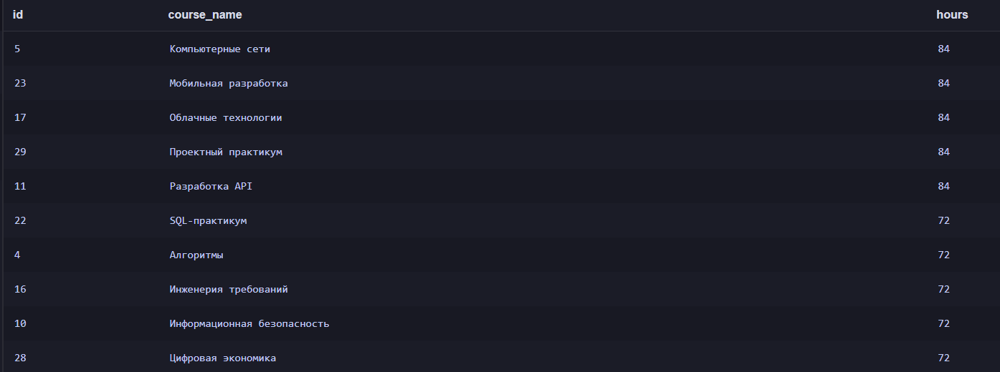

**Сортировка студентов.** Выводим студентов из 2025 года по алфавиту.

```sql
SELECT id, full_name, admission_year FROM students WHERE admission_year = 2025 ORDER BY full_name LIMIT 10;
```

**Результат:**

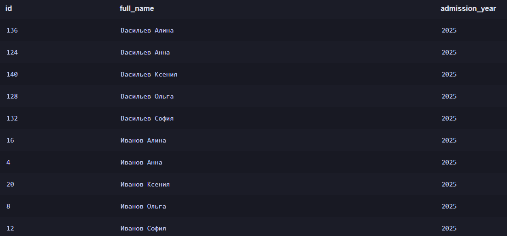

**Вывод:** `WHERE` отбирает нужные строки, `ORDER BY` сортирует, `LIMIT` ограничивает объём вывода.

## Шаг 4. Агрегирование и группировка

**Подсчёт записей.** Определяем общее число записей на курсы.

```sql
SELECT COUNT(*) AS total_enrollments FROM enrollments;
```

**Результат:**

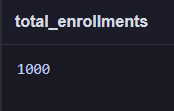

**Агрегатные функции.** Рассчитываем минимальную, максимальную, среднюю и суммарную продолжительность курсов.

```sql
SELECT MIN(hours) AS min_hours, MAX(hours) AS max_hours, ROUND(AVG(hours), 2) AS avg_hours, SUM(hours) AS total_hours FROM courses;
```

**Результат:**

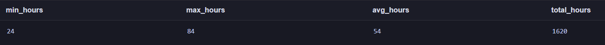

**GROUP BY и HAVING.** Группируем записи по статусу и оставляем статусы, встречающиеся более 100 раз.

```sql
SELECT status, COUNT(*) AS enrollments_count FROM enrollments GROUP BY status HAVING COUNT(*) > 100 ORDER BY enrollments_count DESC;
```

**Результат:**

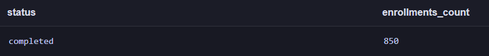

**Вывод:** в базе 850 записей на курсы. `HAVING` отбирает уже готовые группы после агрегирования; условие применяется к результату функции `COUNT(*)`.

## Шаг 5. Объединение связанных таблиц

**Студенты и группы.** Используем `INNER JOIN`, чтобы показать первые 10 студентов вместе с именами их учебных групп.

```sql
SELECT s.full_name AS student_name, g.group_name FROM students s INNER JOIN groups g ON g.id = s.group_id ORDER BY s.id LIMIT 10;
```

**Результат:**

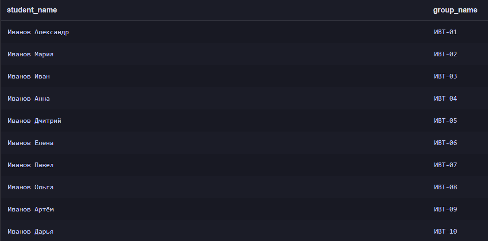

**Курсы и преподаватели.** Используем `INNER JOIN`, чтобы показать первые 10 курсов и ФИО назначенных преподавателей.

```sql
SELECT c.course_name, t.full_name AS teacher_name FROM courses c INNER JOIN teachers t ON t.id = c.teacher_id ORDER BY c.id  LIMIT 10;
```

**Результат:**

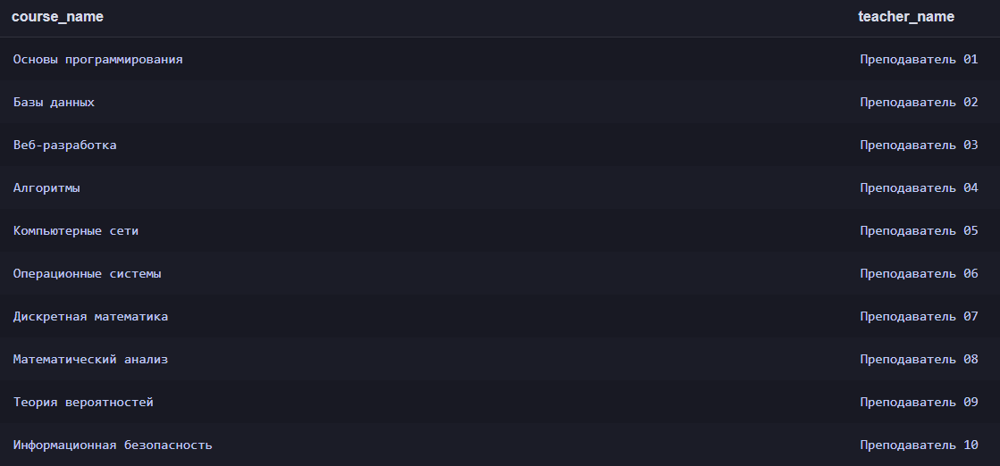

**Все преподаватели и курсы.** Используем `LEFT JOIN`, чтобы сохранить в результате все пункты преподавателей, включая преподавателей без курсов.

```sql
SELECT t.full_name AS teacher_name, c.course_name FROM teachers t LEFT JOIN courses c ON t.id = c.teacher_id ORDER BY t.id, c.id;
```

**Результат:**

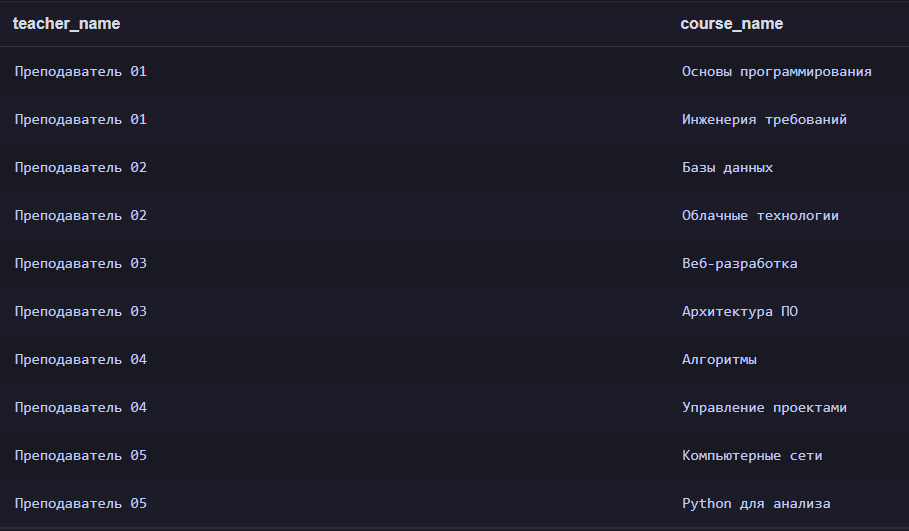

**Вывод:** `INNER JOIN` выводит совпавшие записи, а `LEFT JOIN` сохраняет строки из левой таблицы даже при отсутствии соответствий.

## Шаг 6. Проверка корректности данных

**Проверка корректности оценок.** Проверяем, нет ли оценок с нулевым, отрицательным, превышающим 100 или отсутствующим значением баллов.

```sql
SELECT COUNT(*) AS invalid_scores FROM results WHERE score < 0 OR score > 100 OR score IS NULL;
```

**Результат:**


**Проверка связей результатов.** Проверяем, нет ли результатов, ссылающихся на несуществующую запись на курс.

```sql
SELECT COUNT(*) AS orphan_results FROM results r LEFT JOIN enrollments e ON r.enrollment_id = e.id WHERE e.id IS NULL;
```

**Результат:**

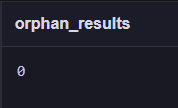

**Вывод:** оба запроса вернули 0. В рамках проведённых проверок нарушений не обнаружено. Это не означает, что проверены абсолютно все возможные ошибки в данных.

## Шаг 7. Индивидуальное аналитическое исследование

**Вариант:** 1

**Исследовательский вопрос:** Какие учебные курсы имеют самую высокую и самую низкую среднюю оценку?

Используемые таблицы: `courses`, `enrollments`, `results`.

**Метод исследования:** с помощью `INNER JOIN`, `GROUP BY`, `COUNT` и `AVG` определяем количество выставленных оценок и средний балл отдельно по каждому учебному курсу.

Для ответа на исследовательский вопрос выполняются два основных SQL-запроса:

**Аналитика по курсам.** Группируем оценки по учебным предметам.

```sql
SELECT c.course_name, COUNT(r.score) AS total_grades,     ROUND(AVG(r.score), 2) AS avg_score  FROM courses c INNER JOIN enrollments e ON c.id = e.course_id INNER JOIN results r ON e.id = r.enrollment_id GROUP BY c.id, c.course_name ORDER BY avg_score DESC;
```
**Результат:**

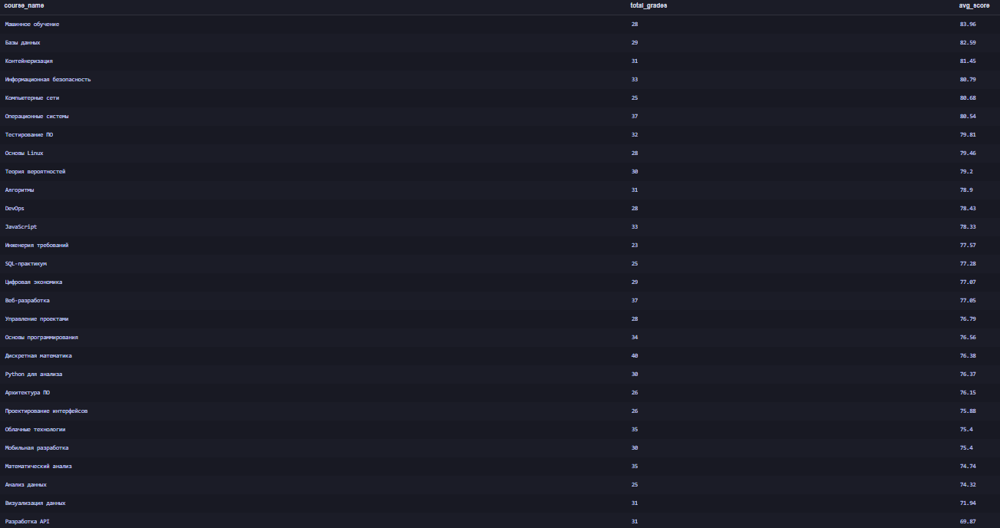

**Дополнительная проверка — курсы без оценок:**

**Неиспользуемые курсы.** Используем `LEFT JOIN` для поиска учебных курсов без единой записи в `results`.

```sql
SELECT id, course_name, hours FROM courses WHERE id NOT IN (SELECT DISTINCT e.course_id FROM enrollments e INNER JOIN results r ON e.id = r.enrollment_id);
```

**Результат:**

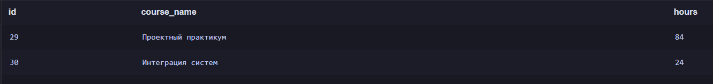

**Аналитические выводы:**

1. Наиболее высокую среднюю оценку имеет курс "Машинное обучение" — 83.96 балла, при этом по нему накоплена стабильная выборка из 28 оценок.
2. Наиболее низкую среднюю успеваемость среди всех оцененных дисциплин показал курс "Разработка API" — 69.97 балла (выставлена 31 оценка). Этот курс стал единственным, чей средний балл опустился ниже границы в 70 баллов.
3. Обнаржуено 2 учебных курса без единой выставленной оценки ("Проектный практикум" и "Интеграция систем").
4. Ограничение анализа: сравнение только лишь по среднему баллу не учитывает качественный и количественный состав студенческих групп.

В работе изучена структура SQLite-базы из шести связанных таблиц, выполнены запросы с `WHERE`, `ORDER BY`, `LIMIT`, агрегатными функциями, `GROUP BY`, `HAVING`, `INNER JOIN`, `LEFT JOIN`; проведены проверки целостности и отдельное аналитическое исследование.

**Ограничения:** оценки отражают успеваемость по выставленным баллам, но не учитывают сложность самих дисциплин и разницу в строгости критериев оценивания у преподавателей. Выводы относятся только к данному учебному набору данных.
